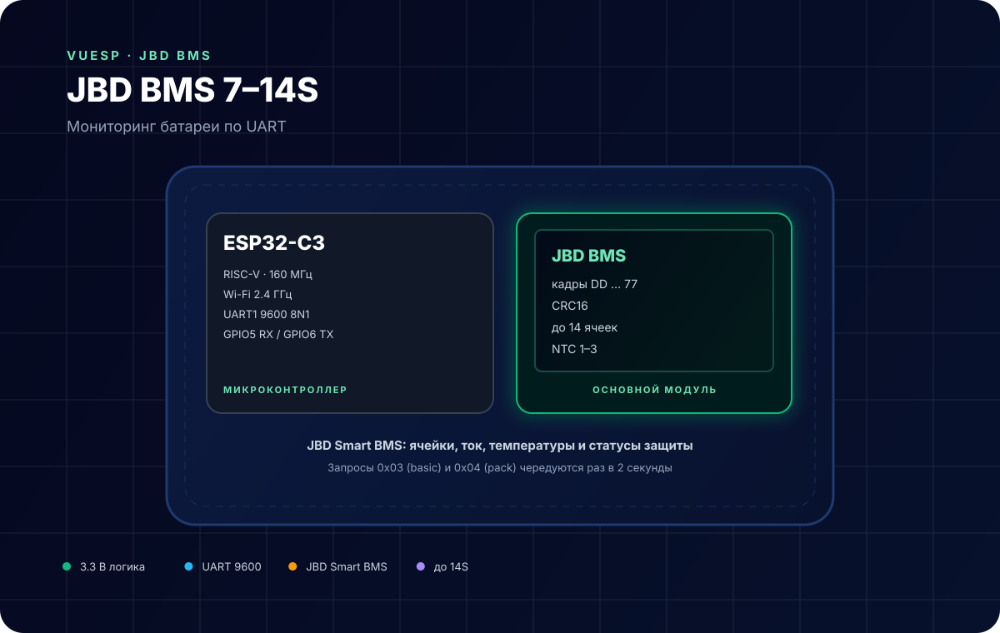
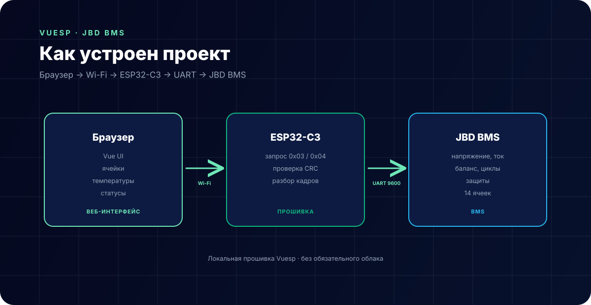

# JBD BMS 7–14S — мониторинг батареи



**Коротко:** `vuesp.jbd-bms-7-14` — прошивка Vuesp для BMS **JBD / Xiaoxiang** на 7–14 последовательных ячеек. ESP32-C3 читает по UART напряжение, ток, ёмкость, циклы, температуры и напряжения ячеек, проверяет CRC и показывает всё в локальном веб-интерфейсе.

## Что это за устройство

JBD BMS — плата защиты и балансировки LiFePO4/Li-ion батарей. У неё есть UART-порт (обычно 4 контакта: GND, RX, TX, VCC), через который отдаются:

- суммарное напряжение и ток;
- остаточная и полная ёмкость;
- количество циклов и дата производства;
- RSOC (остаток заряда, %);
- состояние FET и защиты;
- количество NTC-датчиков и их температуры;
- напряжения каждой ячейки (до 14).

Прошивка по очереди отправляет два запроса: `0x03` (basic info) и `0x04` (cell voltages) — раз в 2 секунды.

## Характеристики

| Параметр | Значение |
| --- | --- |
| Микроконтроллер | ESP32-C3 (RISC-V, 160 МГц) |
| BMS | JBD / Xiaoxiang, 7–14S |
| Интерфейс | UART, 9600 8N1 |
| Протокол | бинарные кадры `0xDD … 0x77` |
| Проверка | CRC16 (сумма с дополнением) |
| Ячейки | до 14, массив `cellVoltage[14]` |
| NTC | 1–3 |
| Среда | PlatformIO + Arduino |

## Распиновка

| Сигнал | GPIO ESP32-C3 | Куда |
| --- | --- | --- |
| RX | GPIO5 | TX BMS |
| TX | GPIO6 | RX BMS |
| GND | GND | GND BMS |

В прошивке (`src/device/device.cpp`):

```cpp
Serial1.begin(9600, SERIAL_8N1, 5, 6);
```

> **Важно.** В этом проекте RX — GPIO5, TX — GPIO6. В `vuesp.DDS6619` наоборот (RX 6, TX 5). Не перепутайте при сборке одного шкафа с обоими устройствами.

## Схема подключения

```text
BMS TX   ─────────►  GPIO5 (RX) ESP32-C3
BMS RX   ◄─────────  GPIO6 (TX) ESP32-C3
BMS GND  ───────────  GND
BMS VCC  ───────────  не подключать (питание BMS своё)
```

- TX/RX соединяются накрест, GND обязателен.
- Не питайте ESP32-C3 от BMS-порта: ток и напряжение порта зависят от модели.
- Кабель BMS—ESP32 лучше делать экранированным, если рядом силовые провода.

## Протокол

Запросы:

| Запрос | Байты | Что возвращает |
| --- | --- | --- |
| Basic info | `DD A5 03 00 FF FD 77` | напряжение, ток, ёмкости, циклы, статусы, NTC |
| Cell voltages | `DD A5 04 00 FF FC 77` | напряжения ячеек |

Ответ — кадр `0xDD … 0x77`. Прошивка проверяет:

- первый байт `0xDD`, последний `0x77`;
- CRC: `~sum + 1` по байтам с индекса 2 до `len - 3`, сравнивается с двумя байтами перед `0x77`.

Разбор basic-кадра (`parseReqBasicMessage`):

| Поле | Смещение | Единицы |
| --- | --- | --- |
| напряжение | 4–5 | 10 мВ |
| ток | 6–7 | 10 мА, знаковый |
| остаточная ёмкость | 8–9 | 10 мА·ч |
| полная ёмкость | 10–11 | 10 мА·ч |
| циклы | 12–13 | шт. |
| дата | 14–15 | упакованная |
| балансировка | 16–19 | битовая маска |
| защита | 20–21 | битовая маска |
| версия | 22 | — |
| RSOC | 23 | % |
| FET | 24 | битовая маска |
| число NTC | 26 | — |
| NTC 1–3 | 27–32 | `(raw − 2731) × 10`, 0.01 °C |

Разбор кадра ячеек: `numOfCells = message[3] / 2`, значения по 2 байта с offset 4, единицы — мВ. Дополнительно считаются минимум, максимум, разброс и среднее.

## Как устроен проект



- `src/device/device.cpp` — запросы, приём кадра, CRC, разбор;
- `src/const/struct.h` — структура `Device` с `cellVoltage[14]`;
- `vue/json/dashboard.json` — плитки напряжения, ячеек, RSOC и температур;
- `vue/` — веб-интерфейс Vuesp.

Данные рассылаются по WebSocket после каждого принятого кадра.

## ScriptRunner

| Функция | Назначение |
| --- | --- |
| `http(method, url, count, num, data)` | заготовка HTTP-запроса |
| `$display` | строковый буфер для сценариев |

Пример:

```text
log('bms ready');
```

## Сборка и прошивка

```bash
cd vue
npm ci
npm run build-web

cd ..
~/.platformio/penv/bin/pio run
~/.platformio/penv/bin/pio run -t buildfs
```

Прошивка: `build/esp32-c3-devkitm-1/firmware.bin`, FS: `build/esp32-c3-devkitm-1/littlefs.bin`.

## Ограничения

- Массив ячеек фиксирован на **14**; для 7S–13S неиспользованные элементы останутся нулями, UI может показывать лишние плитки.
- Поддерживается протокол JBD; уточняйте у продавца, что BMS совместима с Xiaoxiang/JBD Tool.
- Только чтение: балансировка, включение FET и смена параметров не реализованы.
- Температуры приходят в сотых долях °C; в dashboard делится на 100.
- Ток знаковый: заряд и разряд различаются знаком, но в UI это не подписано.
- Один UART — один BMS. Несколько BMS требуют отдельных портов или мультиплексора.

## Источники

- [JBD / Xiaoxiang BMS protocol](https://github.com/smagicld/JBD_BMS)
- [Протокол JBD BMS (описание кадров)](https://github.com/sskorol/jbd-bms-mqtt)
- [Документация Vuesp](https://docs.vuesp.ru)
